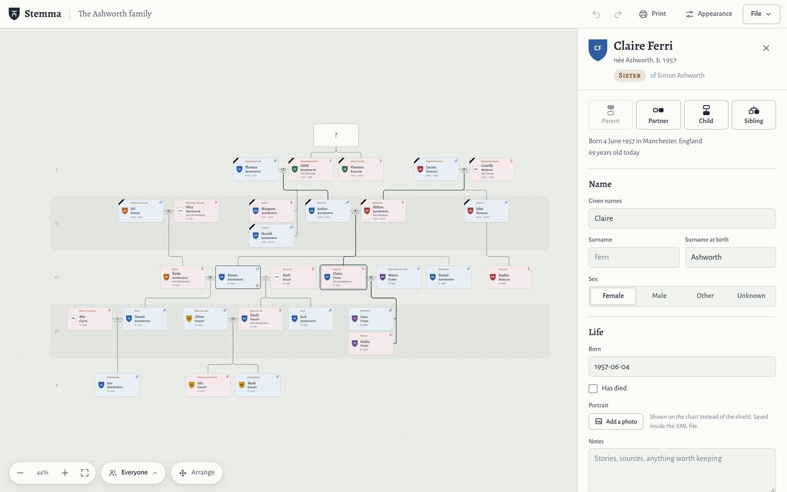
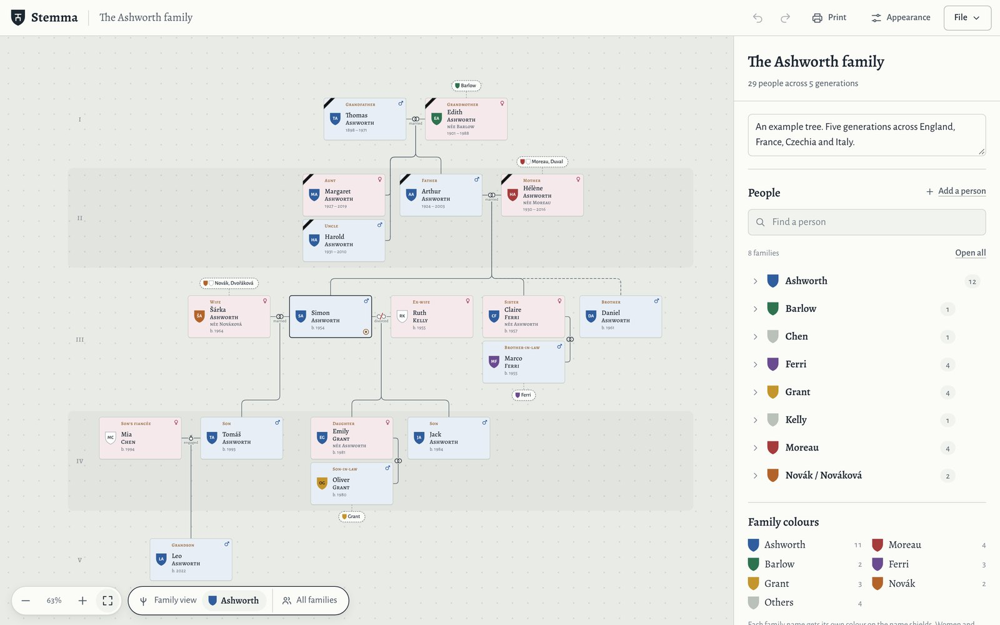
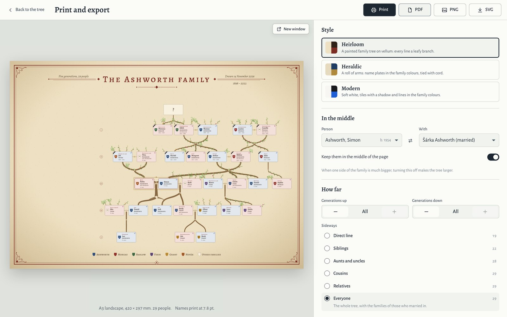
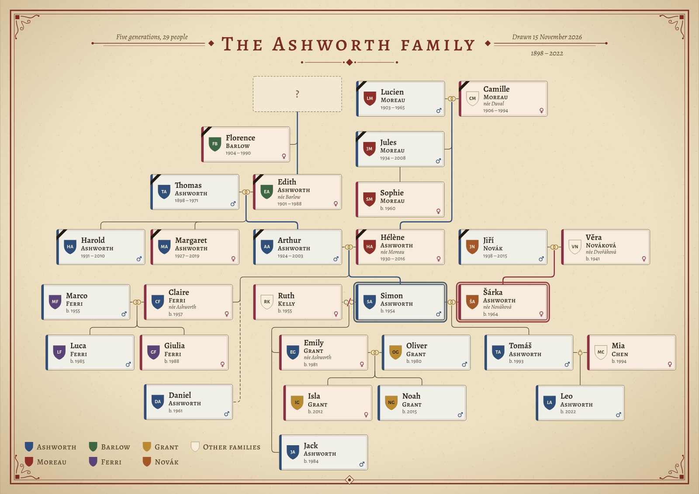

# Stemma

Angular app for mapping a family and getting a clear family tree drawn and printed for you.

    

**Live demo:** [firestone82.github.io/stemma](https://firestone82.github.io/stemma/)

## About

Stemma lets you add people and how they are related, and lays the chart out for you around the person you centre on, each family coloured. Families hang together wherever there is room, with no line crossing another even for remarriages, divorces, adoptions or cousin marriages. Trees are printed as posters that fill the sheet, A4 to A0, with cards as big as the paper allows, and are saved as a versioned XML file. Everything runs in the browser and no data leaves your machine.

## Features

- Automatic layout for real families: families hang together wherever there is room, packed outline to outline with padding between them, each one as wide or as narrow as fills the space best, and no line crosses another; someone who married more than once stands between their partners
- Family view: one family on its own; where a family it is joined to would begin there is a button in a card's place, which brings that family in
- One card for everyone, on the chart and in print: shield with initials in the family colour, name, surname and surname at birth ("née Unknown" for a married woman whose own is not known), dates in years or in full, sex as an accent, a ribbon across the top right corner for the deceased, a badge on records with a mistake - every part can be switched off, the shield at the top or in the middle, and a card without the shield is narrower
- Relationship names to the centred person (great-aunt, sister-in-law, first cousin once removed, ...)
- Relationship status: married, engaged, partners, separated, divorced, widowed, annulled
- Twins and multiple births, people with unknown names, unknown parents
- Surnames that fill themselves in, including Czech female forms (Mikula -> Mikulova)
- Family colours on heraldic shields, with the Polish, the German and the Czech spelling of a name as one family (Nowak and Novák, Schmidt and Šmíd), and a soft background behind each family's cards on the chart if you like; light and dark mode
- Print studio in the **Heritage** style: the page is shaped to the paper for the biggest cards and the least empty paper, upright or on its side; families can be packed tightly, a longer search can spread them into room that would stay empty, and couples can stand one over the other in a column, if you prefer; the couple in the middle is ringed and each one's direct line drawn in their colour; drag a card to move it (its lines follow, guides line it up with other cards, Alt places it freely), click a line to leave out everyone who hangs on it, right-click a card to bring that person's parents, brothers and sisters or whole family onto the print (the parents of a former partner, say), and undo any of it; the title and the family names are sized to the sheet and the cards (a size typed in can be swapped for the suggested one with a click) and can be dragged anywhere: a moved box shows its lettering where it would go, and the page is drawn again only once the move is applied; either can be held at an anchor instead (a corner, the middle of a side), where it stays whatever its size, and the names can stand in any corner of a box made bigger than they need; left alone, the family names stand across the foot or in the corner the tree leaves empty; the tree keeps clear of both; the words on the cards can be a size bigger, and a card whose names do not fit can be as wide as they need; a big tree's page is drawn a piece at a time, so the studio keeps answering, and a change made meanwhile drops the drawing and starts the page wanted now
- Paper sizes A4 to A0, US Letter and Tabloid, each with its own smallest readable card; stronger lines and marks if wanted; the couple in the middle framed as one; export to printer, PDF, PNG or SVG
- Versioned XML format with schema ([schema/stemma-1.xsd](schema/stemma-1.xsd)) and autosave in the browser
- Undo/redo, keyboard navigation, English and Czech, mobile layout

## Showcase



The family view shows one family at a time. Where a family it is joined to would begin, a dashed button stands in a card's place: press it and the family comes in.



The print studio: pick the paper, who the page is drawn around and what the cards show, then print or export.



[](docs/screenshots/print-heritage.jpg)

## Requirements

- Node.js 22.22.3+ or 24.15+
- npm 10+

## Setup

1. Clone the repository:

   ```bash
   git clone https://github.com/Firestone82/stemma.git
   cd stemma
   ```

2. Install dependencies:

   ```bash
   npm install
   ```

3. Start the development server:

   ```bash
   npm start
   ```

   The app runs at `http://localhost:4200`. An example tree is in [samples/ashworth-family.xml](samples/ashworth-family.xml).

4. Build for production:
   ```bash
   npm run build
   ```
   The output in `dist/stemma/browser` is a static site that can be hosted anywhere.

Other scripts: `npm test` (Vitest), `npm run lint` (ESLint), `npm run format` (Prettier).

## License

[MIT](LICENSE)
